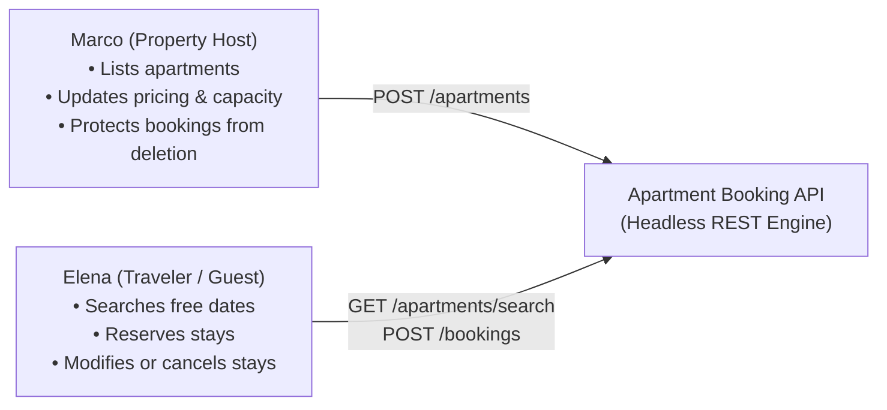
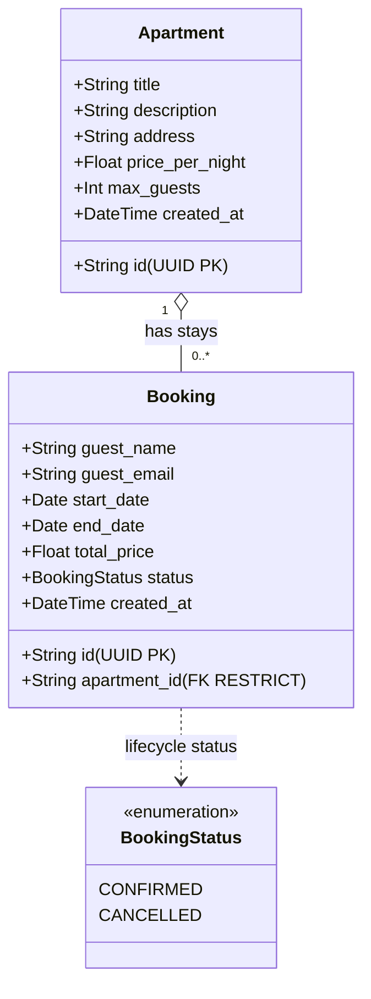

# Apartment Booking API

A headless, RESTful backend service for managing apartment listings, searching date-range availability, and handling reservations with strict collision prevention. Built for the **Agile Software Development** course (Project 1, Free University of Bozen-Bolzano).

---

## 📌 Table of Contents

- [1. Project Overview](#1-project-overview)
- [2. Selected Project Case & First Users](#2-selected-project-case--first-users)
- [3. Domain Concept Map](#3-domain-concept-map)
- [4. User Stories & Acceptance Criteria](#4-user-stories--acceptance-criteria)
- [5. Technology Stack & Design Decisions](#5-technology-stack--design-decisions)
- [6. Architecture & Database Persistence](#6-architecture--database-persistence)
- [7. Project Directory Structure](#7-project-directory-structure)
- [8. Quickstart Guide (3 Steps to Run)](#8-quickstart-guide-3-steps-to-run)
- [9. Headless API Documentation (Swagger & OpenAPI)](#9-headless-api-documentation-swagger--openapi)
- [10. 🎮 Demonstrating the System (Two Options)](#10--demonstrating-the-system-two-options)
  - [Option 1: Automated Demo Script (`scripts/demo.sh`)](#option-1-automated-demo-script-scriptsdemosh)
  - [Option 2: Step-by-Step Manual cURL Walkthrough (Beginner-Friendly)](#option-2-step-by-step-manual-curl-walkthrough-beginner-friendly)
- [11. Verifying Data Persistence Across Server Restarts](#11-verifying-data-persistence-across-server-restarts)
- [12. Running Automated Tests & Coverage](#12-running-automated-tests--coverage)
- [13. Database Management & Reset](#13-database-management--reset)
- [14. Checkpoint 1 Compliance Checklist](#14-checkpoint-1-compliance-checklist)

---

## 1. Project Overview

This project implements an authoritative, headless backend engine for short-term apartment rentals. 

### What problem does it solve?
In vacation and apartment rentals, the single most critical failure mode is **double booking** (two guests reserving the same apartment for overlapping dates). This leads to displaced travelers, host penalties, and operational disruption.

This API provides:
1. **Catalog Management:** Hosts can list, update, and remove apartments.
2. **Date Availability Search:** Travelers can search for apartments free during specific calendar dates.
3. **Reservation Engine:** Guests can create, view, update, and cancel bookings with automated price calculation.
4. **Collision Prevention Engine:** A mathematical guarantee that overlapping dates for the same apartment return HTTP `409 Conflict` and are never committed to the database.
5. **Zero-Configuration Persistence:** Relational SQLite storage persisting data across restarts without external database servers or Docker containers.

---

## 2. Selected Project Case & First Users

### The Case: *Urban Short-Stay Rental Management*
A self-contained platform facilitating short-term rentals between apartment owners (hosts) and traveling guests.

### First Users (Personas)



1. **Marco — The Property Host**
   - **Role:** Apartment owner/property manager in Bolzano.
   - **Needs:** Add apartments with pricing per night, maximum guests, and descriptions; update details; remove unlisted places.
   - **Pain Point:** Avoid double bookings at all costs to preserve host reputation, and ensure active reservations are not accidentally orphaned if an apartment is deleted.

2. **Elena — The Traveler / Guest**
   - **Role:** Tourist or business traveler.
   - **Needs:** Discover apartments available for her travel dates; book a stay; inspect confirmation details; adjust dates if plans change; cancel if necessary.
   - **Pain Point:** Frustrated when double bookings occur or when cancellation policies are opaque.

---

## 3. Domain Concept Map

The domain concept map illustrates the core entities, their attributes, and their relationships:



### Key Business Rules & Boundaries

1. **Discrete Date Nights & Half-Open Intervals $[check\_in, check\_out)$:**
   Stays are modeled as discrete calendar dates where `start_date` is the check-in day and `end_date` is the check-out day.
   - **Same-day turnover is strictly permitted:** Guest A checking out on `2026-11-05` and Guest B checking in on `2026-11-05` do **not** collide.
   - **Duration:** Exactly `(end_date - start_date).days` nights.
   - **Total Price:** Automatically computed as:
     $$\text{total\_price} = (\text{end\_date} - \text{start\_date}).\text{days} \times \text{apartment.price\_per\_night}$$

2. **The Canonical Overlap Formula:**
   Two bookings for the same apartment overlap if and only if:
   $$\text{Existing.start\_date} < \text{Requested.end\_date} \quad \text{AND} \quad \text{Existing.end\_date} > \text{Requested.start\_date}$$
   AND $\text{Existing.status} \neq \text{'CANCELLED'}$.

3. **Soft Cancellation & Date Release:**
   Cancelling a reservation (`POST /bookings/{id}/cancel`) marks `status = 'CANCELLED'`. This retains booking history for auditing while **immediately freeing up the calendar dates** for other guests. Cancelled bookings are immutable.

4. **Referential Integrity & Deletion Protection:**
   Foreign key constraints are enforced with `ondelete="RESTRICT"`. An apartment with active/confirmed bookings **cannot be deleted**, preventing orphaned guest reservations.

---

## 4. User Stories & Acceptance Criteria

| User Story | Method & Endpoint | Acceptance Criteria |
| :--- | :--- | :--- |
| **US1: Manage Apartments** | `POST /apartments`<br>`GET /apartments`<br>`GET /apartments/{id}`<br>`PUT /apartments/{id}`<br>`DELETE /apartments/{id}` | Full CRUD. Adding an apartment requires title, address, positive price, and capacity. Deleting an apartment with active bookings returns `409 Conflict`. |
| **US2: Manage Bookings** | `POST /bookings`<br>`GET /bookings`<br>`GET /bookings/{id}`<br>`PUT /bookings/{id}`<br>`POST /bookings/{id}/cancel` | Create reservations with automatic price calculation. List bookings with pagination (`limit`/`offset`). Update dates or transfer to another apartment. Soft-cancel stays via dedicated action endpoint. |
| **US3: Date Range Search** | `GET /apartments/search?start_date=...&end_date=...` | Returns all apartments that have **zero active bookings** overlapping the requested date window. Rejects invalid queries (`start_date >= end_date`) with `400 Bad Request`. |
| **US4: Overlap Prevention** | Evaluated on `POST /bookings` & `PUT /bookings/{id}` | Rejects colliding reservations with HTTP `409 Conflict`. Allows same-day turnaround. Applies self-exclusion when updating dates within the same apartment. |

---

## 5. Technology Stack & Design Decisions

- **Runtime:** Python 3.10+ (tested on Python 3.14 on macOS arm64).
- **Web Framework:** [FastAPI](https://fastapi.tiangolo.com/) (high performance, auto-generates OpenAPI 3.1 & Swagger UI).
- **Data Validation:** [Pydantic v2](https://docs.pydantic.dev/) (automatic whitespace stripping, email regex validation, date order validators).
- **ORM & Database:** [SQLAlchemy 2.0](https://www.sqlalchemy.org/) with [SQLite](https://www.sqlite.org/).
- **Concurrency & Locking:** SQLite configured with Write-Ahead Logging (`PRAGMA journal_mode = WAL;`), `PRAGMA foreign_keys = ON;`, and a 30-second busy timeout.
- **Server:** [Uvicorn](https://www.uvicorn.org/) (ASGI web server).
- **Testing:** [pytest](https://docs.pytest.org/) and [HTTPX](https://www.python-httpx.org/) with an isolated in-memory SQLite database (`StaticPool`) guaranteeing zero test pollution on disk.

---

## 6. Architecture & Database Persistence

### Do I need to install or run a database?
> [!IMPORTANT]
> **No!** SQLite is an embedded database included directly in the Python standard library. You do **not** need PostgreSQL, MySQL, Docker, or background database services. 
> 
> When the API starts, it automatically creates the database file at `./data/apartments.db` and initializes all tables and indexes. All data is saved persistently to disk and survives server restarts.

### Layered Architecture

```
[ HTTP Requests / cURL / Swagger UI ]
                 │
                 ▼
     [ FastAPI Routers / Endpoints ]
                 │  (Pydantic validation & whitespace trimming)
                 ▼
    [ Service Layer / Business Logic ]  <─── Overlap Prevention Engine
                 │
                 ▼
   [ Data Layer (SQLAlchemy ORM) ]
                 │  (Composite Index & Foreign Key RESTRICT)
                 ▼
   [ SQLite File: ./data/apartments.db (WAL Mode) ]
```

---

## 7. Project Directory Structure

```text
apartment-booking/
├── README.md               # Complete project documentation & demonstration guide
├── pyproject.toml          # Pytest, coverage, and warning suppression settings
├── requirements.txt        # Pinned Python dependencies
├── data/
│   └── .gitkeep            # Directory holding the persistent SQLite DB file
├── dev_plans/
│   ├── roadmap.md          # Multi-phase development roadmap & dependency graph
│   ├── part0-scaffold/plan.md # Plan for initial setup & test harness
│   ├── part1-apartments/plan.md # Plan for apartment catalog CRUD
│   ├── part2-bookings/plan.md # Plan for booking lifecycle & overlap engine
│   └── part3-search/plan.md # Plan for date range availability search
├── app/
│   ├── __init__.py
│   ├── main.py             # FastAPI entrypoint, lifespan startup, & /health route
│   ├── config.py           # Application settings (DB path, metadata)
│   ├── database.py         # SQLAlchemy engine, PRAGMA listeners, & get_db dependency
│   ├── models.py           # Database entities (Apartment, Booking, BookingStatus)
│   ├── schemas.py          # Pydantic validation schemas
│   ├── services/
│   │   ├── __init__.py
│   │   ├── apartment_service.py # Apartment catalog rules & availability search
│   │   └── booking_service.py # Overlap validation engine & booking lifecycle
│   └── routers/
│       ├── __init__.py
│       ├── apartments.py   # /apartments REST endpoints (US1, US3)
│       └── bookings.py     # /bookings REST endpoints (US2, US4)
└── tests/
    ├── __init__.py
    ├── conftest.py         # In-memory SQLite fixtures with zero file pollution
    ├── test_health.py      # Health check and root redirect tests
    ├── test_database.py    # Engine connection, PRAGMA, and settings tests
    ├── test_models_schemas.py # Schema validation and ORM persistence tests
    ├── test_apartment_schemas.py # US1 apartment input validation tests
    ├── test_apartment_service.py # US1 apartment service and deletion policy tests
    ├── test_apartments.py  # US1 apartment REST API tests
    ├── test_search.py      # US3 availability search tests
    ├── test_bookings.py    # US2 booking lifecycle, pricing, and error handling tests
    └── test_overlap.py     # US4 comprehensive overlap collision tests
```

---

## 8. Quickstart Guide (3 Steps to Run)

### Step 1: Clone Repository
```bash
git clone https://github.com/rmnfdrzq/apartment-booking.git
cd apartment-booking
```

### Step 2: Create & Activate Virtual Environment
```bash
python3 -m venv .venv
source .venv/bin/activate
```
*(On Windows PowerShell: `.venv\Scripts\Activate.ps1`)*

### Step 3: Install Dependencies & Start the Server
```bash
pip install -r requirements.txt
uvicorn app.main:app --reload --host 127.0.0.1 --port 8000
```

Once running:
- **API Base URL:** `http://127.0.0.1:8000`
- **Interactive Documentation:** `http://127.0.0.1:8000/docs`
- **Database file:** Automatically created at `./data/apartments.db`.

---

## 9. Headless API Documentation (Swagger & OpenAPI)

To satisfy **Shared Project Constraint 1** (*documented API callable without a GUI*), FastAPI automatically exposes machine-readable and browser-inspectable documentation:

| Documentation Interface | URL | Description |
| :--- | :--- | :--- |
| **Interactive Swagger UI** | [http://127.0.0.1:8000/docs](http://127.0.0.1:8000/docs) | Allows exploring endpoints, request schemas, status codes, and trying queries directly. |
| **ReDoc Documentation** | [http://127.0.0.1:8000/redoc](http://127.0.0.1:8000/redoc) | Clean, readable reference documentation. |
| **Raw OpenAPI 3.1 JSON** | [http://127.0.0.1:8000/openapi.json](http://127.0.0.1:8000/openapi.json) | Standards-compliant OpenAPI JSON schema for headless clients. |

---

## 10. 🎮 Demonstrating the System (Two Options)

For grading and verification, you can choose between two demonstration approaches:

---

### Option 1: Automated Demo Script (`scripts/demo.sh`)

Verify the entire system with **one command** (from the project root, with dependencies installed):

```bash
./scripts/demo.sh
```

The script starts its own server on a free port with a **temporary database** (your `./data/apartments.db` is never touched), runs the full user journey, restarts the server to prove persistence, and cleans up afterwards. It takes a few seconds.

| Step | What is checked |
| :--- | :--- |
| 1 | `GET /health` → `200` |
| 2 | Host adds 2 apartments (`201`), invalid price rejected (`422`), price updated (`PUT` → `200`), apartments listed and viewed (US1) |
| 3 | Guest searches a date range → both apartments available; invalid range → `400` (US3) |
| 4 | Elena books apartment 1 → `201`, price = nights × price per night; apartment disappears from search (US2) |
| 5 | Overlapping booking → `409`; same-day turnaround → `201` (US4) |
| 6 | Second guest books apartment 2 instead → `201` |
| 7 | Booking dates changed and booking transferred to another apartment, with re-checked overlaps and recalculated prices (US2, US4) |
| 8 | Elena cancels → `CANCELLED` (US2) |
| 9 | Search again → apartment 1 is free again (US3) |
| 10 | Server is stopped and restarted → all changes are still there (persistence) |
| 11 | `/docs` and `/openapi.json` document every endpoint |
| 12 | Apartment with active stays cannot be removed (`409`); after cancellations it is removed (`204`) (US1) |

Every step asserts the HTTP status code and key response values. Each check prints `✔`; the first failed check prints `✘` with the server response and the script exits with code `1`.

Dates are calculated relative to today, so the demo never goes out of date.

**Against a server you already started** (e.g. to watch requests in its log), pass its URL. The restart step is then skipped, and the demo removes the data it created at the end:
```bash
BASE_URL=http://127.0.0.1:8000 ./scripts/demo.sh
```

Help: `./scripts/demo.sh --help`. The script works on macOS and Linux (bash 3.2+, `curl`, Python; no `jq` needed) and runs inside the test suite as `tests/test_demo_script.py`.

---

### Option 2: Step-by-Step Manual cURL Walkthrough (Beginner-Friendly)

If you prefer to execute commands one by one to inspect the requests and responses, open a terminal with the server running and follow these steps.

> [!TIP]
> The commands below use standard bash variables (`APT_ID` and `BOOKING_ID`) so you can copy and paste them directly into your terminal in order!
>
> Run the steps **in order on an empty database** (`rm -f data/apartments.db` before starting the server). The example dates are in November 2027; if they are already in the past, replace them with future dates — bookings that have already ended no longer count as active.

#### Step 1: Verify the API is Alive
Check that the service is running:
```bash
curl -s -X GET http://127.0.0.1:8000/health
```
**Expected Output:** `200 OK`
```json
{"status":"ok","app":"Apartment Booking API","version":"1.0.0"}
```

---

#### Step 2: Manage Apartments (US1)

##### 2.1 Add an Apartment (Marco the Host)
Add a listing with pricing of 100.0 € per night:
```bash
RESPONSE=$(curl -s -X POST http://127.0.0.1:8000/apartments \
  -H "Content-Type: application/json" \
  -d '{
    "title": "Sunny Alpine Studio",
    "description": "Cozy studio near central square with mountain views.",
    "address": "Piazza Walther 4, Bolzano",
    "price_per_night": 100.0,
    "max_guests": 2
  }')
echo $RESPONSE
```
**Expected Output:** `201 Created` with a generated UUID `id`.  
Save the apartment ID to a variable:
```bash
export APT_ID=$(echo $RESPONSE | grep -o '"id":"[^"]*' | cut -d'"' -f4)
echo "Using Apartment ID: $APT_ID"
```

##### 2.2 List All Apartments
```bash
curl -s -X GET http://127.0.0.1:8000/apartments
```

##### 2.3 Inspect Single Apartment Details
```bash
curl -s -X GET "http://127.0.0.1:8000/apartments/${APT_ID}"
```

##### 2.4 Update Apartment Pricing
Increase the price per night to 120.0 €:
```bash
curl -s -X PUT "http://127.0.0.1:8000/apartments/${APT_ID}" \
  -H "Content-Type: application/json" \
  -d '{
    "title": "Sunny Alpine Studio (Renovated)",
    "price_per_night": 120.0
  }'
```

---

#### Step 3: Search for Available Apartments (US3)

Find apartments available for a stay between `2027-11-01` and `2027-11-05`:
```bash
curl -s -X GET "http://127.0.0.1:8000/apartments/search?start_date=2027-11-01&end_date=2027-11-05"
```
**Expected Output:** `200 OK` with an array containing `Sunny Alpine Studio (Renovated)` (since it currently has no bookings).

An invalid range (check-out before check-in) is rejected:
```bash
curl -s -i "http://127.0.0.1:8000/apartments/search?start_date=2027-11-05&end_date=2027-11-01"
```
**Expected Output:** `HTTP/1.1 400 Bad Request`

---

#### Step 4: Create a Booking with Automatic Price Calculation (US2)

Elena reserves the apartment from `2027-11-01` to `2027-11-05` (4 nights $\times$ 120.0 € = 480.0 €):
```bash
BOOKING_RESP=$(curl -s -X POST http://127.0.0.1:8000/bookings \
  -H "Content-Type: application/json" \
  -d "{
    \"apartment_id\": \"${APT_ID}\",
    \"guest_name\": \"Elena Rossi\",
    \"guest_email\": \"elena.rossi@example.com\",
    \"start_date\": \"2027-11-01\",
    \"end_date\": \"2027-11-05\"
  }")
echo $BOOKING_RESP
```
**Expected Output:** `201 Created`
```json
{
  "id": "e67d4987-...",
  "apartment_id": "...",
  "guest_name": "Elena Rossi",
  "guest_email": "elena.rossi@example.com",
  "start_date": "2027-11-01",
  "end_date": "2027-11-05",
  "total_price": 480.0,
  "status": "CONFIRMED",
  "created_at": "..."
}
```
Save the booking ID:
```bash
export BOOKING_ID=$(echo $BOOKING_RESP | grep -o '"id":"[^"]*' | cut -d'"' -f4)
echo "Using Booking ID: $BOOKING_ID"
```

---

#### Step 5: Verify Overlapping Booking Prevention (US4)

##### 5.1 Test Collision Rejection (Nov 3 to Nov 7)
Bob attempts to book the same apartment for dates overlapping Elena's stay:
```bash
curl -s -i -X POST http://127.0.0.1:8000/bookings \
  -H "Content-Type: application/json" \
  -d "{
    \"apartment_id\": \"${APT_ID}\",
    \"guest_name\": \"Bob Smith\",
    \"guest_email\": \"bob.smith@example.com\",
    \"start_date\": \"2027-11-03\",
    \"end_date\": \"2027-11-07\"
  }"
```
**Expected Output:** **`HTTP/1.1 409 Conflict`**
```json
{
  "detail": "Apartment is not available for the requested date range: 2027-11-03 to 2027-11-07. Collides with an existing booking."
}
```
*The double booking is rejected, protecting Elena's stay.*

##### 5.2 Test Same-Day Turnover (Nov 5 to Nov 10)
Charlie books starting on the exact day Elena checks out:
```bash
curl -s -X POST http://127.0.0.1:8000/bookings \
  -H "Content-Type: application/json" \
  -d "{
    \"apartment_id\": \"${APT_ID}\",
    \"guest_name\": \"Charlie Brown\",
    \"guest_email\": \"charlie@example.com\",
    \"start_date\": \"2027-11-05\",
    \"end_date\": \"2027-11-10\"
  }"
```
**Expected Output:** `201 Created`  
*(Same-day turnover $[start, end)$ is permitted: check-in on checkout date succeeds).*

---

#### Step 6: Update a Booking / Transfer Apartment (US2)

Elena wants to extend her stay until Nov 6, but Charlie checks in on Nov 5:
```bash
curl -s -X PUT "http://127.0.0.1:8000/bookings/${BOOKING_ID}" \
  -H "Content-Type: application/json" \
  -d '{"end_date": "2027-11-06"}'
```
**Expected Output:** `409 Conflict` — the changed dates are re-checked against other bookings.

Instead, she arrives one day earlier (check-in Oct 31 instead of Nov 1, total 5 nights $\times$ 120.0 € = 600.0 €) and updates her email:
```bash
curl -s -X PUT "http://127.0.0.1:8000/bookings/${BOOKING_ID}" \
  -H "Content-Type: application/json" \
  -d '{
    "start_date": "2027-10-31",
    "guest_email": "elena.updated@example.com"
  }'
```
**Expected Output:** `200 OK` with updated `start_date: 2027-10-31` and recalculated `total_price: 600.0`.  
*(Self-exclusion logic prevents the booking from colliding with its own previous dates).*

---

#### Step 7: Cancel a Booking & Release Dates (US2)

Elena cancels her reservation:
```bash
curl -s -X POST "http://127.0.0.1:8000/bookings/${BOOKING_ID}/cancel"
```
**Expected Output:** `200 OK` with `"status": "CANCELLED"`.

Now Bob books the dates Elena released (Nov 1 to Nov 5), which were blocked a moment ago:
```bash
curl -s -X POST http://127.0.0.1:8000/bookings \
  -H "Content-Type: application/json" \
  -d "{
    \"apartment_id\": \"${APT_ID}\",
    \"guest_name\": \"Bob Smith\",
    \"guest_email\": \"bob.smith@example.com\",
    \"start_date\": \"2027-11-01\",
    \"end_date\": \"2027-11-05\"
  }"
```
**Expected Output:** `201 Created`  
*(The dates are immediately free for new bookings following cancellation).*

---

#### Step 8: Verify Active Booking Deletion Protection

Marco attempts to delete an apartment that has Bob's and Charlie's active confirmed bookings:
```bash
curl -s -i -X DELETE "http://127.0.0.1:8000/apartments/${APT_ID}"
```
**Expected Output:** **`HTTP/1.1 409 Conflict`**  
*(Apartments with active stays cannot be removed, protecting Bob's and Charlie's bookings. Once their bookings are cancelled or finished, `DELETE` succeeds with `204 No Content`.)*

---

## 11. Verifying Data Persistence Across Server Restarts

To prove **Shared Project Constraint 2** (*data survives application restarts*):

1. Note the existing booking from Step 7:
   ```bash
   curl -s -X GET http://127.0.0.1:8000/bookings
   ```
2. Stop the running server in Terminal 1 by pressing `Ctrl + C`.
3. Verify that the SQLite file exists on disk:
   ```bash
   ls -lh data/apartments.db
   ```
4. Restart the server in Terminal 1:
   ```bash
   uvicorn app.main:app --reload --host 127.0.0.1 --port 8000
   ```
5. Query the bookings list again in Terminal 2:
   ```bash
   curl -s -X GET http://127.0.0.1:8000/bookings
   ```
   **Result:** The previously created apartment and booking are still completely intact.

---

## 12. Running Automated Tests & Coverage

The project includes an automated test suite verifying all 4 user stories, input validation, and boundary conditions.

### Run All Tests:
```bash
pytest -v
```

### Run Tests with Coverage Report:
```bash
pytest --cov=app --cov-report=term-missing
```

### Key Test Properties:
- **Fast Execution:** the whole suite runs in a few seconds.
- **Zero Test Pollution:** Tests run against an in-memory SQLite database (`StaticPool`) and **never touch or pollute** `./data/apartments.db`.
- **High Coverage (~98%):** unit tests (schemas, services), API integration tests for all four user stories, and an end-to-end test that runs `scripts/demo.sh` against a real server process.

---

## 13. Database Management & Reset

If you want to clear all data and start completely fresh:
```bash
rm data/apartments.db
```
The next time Uvicorn starts, a pristine, empty database will be recreated automatically.

---

## 14. Checkpoint 1 Compliance Checklist

| Checkpoint 1 Criteria | Implementation Evidence | Status |
| :--- | :--- | :---: |
| **Selected Project Case & First Users** | Documented in [Section 2](#2-selected-project-case--first-users) (Marco the Host and Elena the Guest). | ✅ |
| **Domain Concept Map** | Visual Mermaid class diagram and business rules in [Section 3](#3-domain-concept-map). | ✅ |
| **Running Application Implementing Stories** | All 4 user stories implemented and verified via automated test suite and live API. | ✅ |
| **Documented API Without GUI** | Interactive Swagger UI (`/docs`), ReDoc (`/redoc`), and raw OpenAPI JSON spec (`/openapi.json`). | ✅ |
| **Persistent Storage Surviving Restarts** | SQLite file at `./data/apartments.db` with WAL mode and foreign key enforcement. | ✅ |
| **Instructions to Start & Try Commands** | Complete [Quickstart Guide](#8-quickstart-guide-3-steps-to-run) and [Step-by-Step cURL Guide](#10--demonstrating-the-system-two-options). | ✅ |
