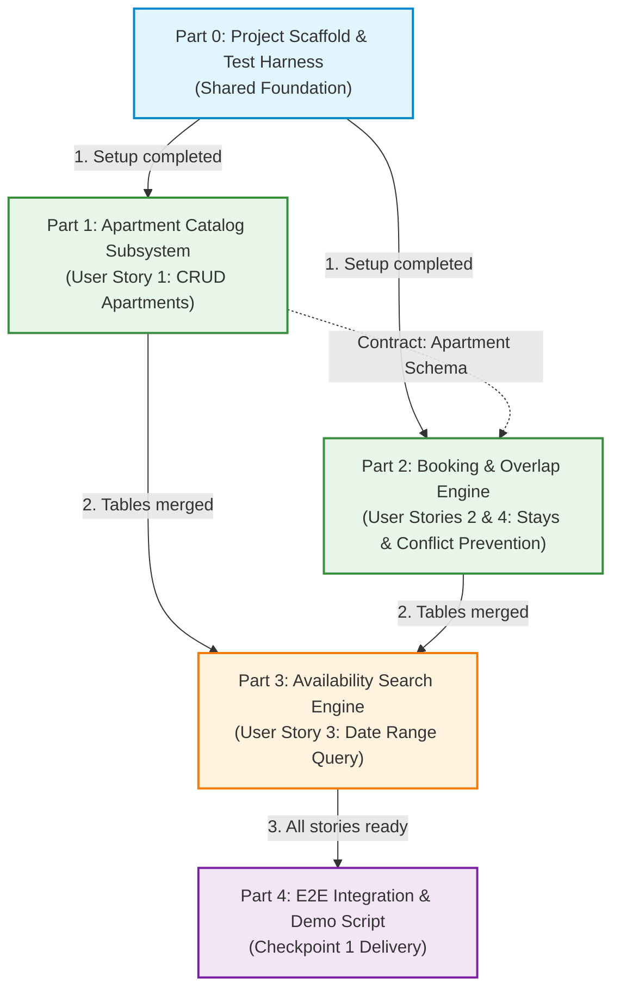

# Project Implementation Roadmap: Apartment Booking API

This document outlines the architectural decomposition, step-by-step implementation phases, dependencies, and execution strategies (sequential vs. simultaneous) for **Checkpoint 1**.

---

## 📌 Executive Summary

The project is decomposed into **5 distinct parts** (Part 0 through Part 4). Each part represents a vertical slice or foundational block with its own automated tests, API contracts, and clear definition of done.



---

## 🔗 Dependency & Concurrency Matrix

| Part | Focus | User Stories | Depends On | Execution Mode |
| :--- | :--- | :--- | :--- | :--- |
| **Part 0** | Scaffold, DB Engine & Pytest Harness | *All (Foundation)* | None | **Sequential** (Must be done first by 1 developer) |
| **Part 1** | Apartment Management (CRUD) | **US1** | Part 0 | **Simultaneous / Independent** with Part 2 |
| **Part 2** | Booking Lifecycle & Overlap Engine | **US2, US4** | Part 0 *(and Apartment ID contract)* | **Simultaneous / Independent** with Part 1 |
| **Part 3** | Availability Search Query | **US3** | Part 1, Part 2 | **Sequential** (After Parts 1 & 2 models are merged) |
| **Part 4** | E2E Demo, Persistence Proof & Checkpoint 1 | *Delivery* | Parts 0, 1, 2, 3 | **Final Step** (Integration & Validation) |

---

## ⚡ Sequential vs. Simultaneous Execution Guide

### What MUST be done sequentially?
1. **Part 0 must precede everything:** The database engine (`app/database.py`), configuration (`app/config.py`), and test harness (`tests/conftest.py`) must exist before anyone writes domain features.
2. **Part 3 requires models from Parts 1 & 2:** Availability search needs both the `Apartment` table and the `Booking` table to determine which apartments do not have overlapping reservations.
3. **Part 4 requires a functioning system:** The demo script exercises the entire user journey through the live API.

### What CAN be implemented simultaneously and independently?
**Part 1 (Apartments) and Part 2 (Bookings & Overlap) can be developed in parallel!**
- **How? (Contract-First Design):**
  - Both developers agree on the `Apartment` primary key format (e.g. `UUID` string or `int`) and the field `price_per_night: float`.
  - **Developer A** works on `app/routers/apartments.py` and `tests/test_apartments.py`.
  - **Developer B** works on `app/routers/bookings.py`, `app/services/booking_service.py`, and `tests/test_bookings.py`. In Developer B's tests, an apartment record is simply seeded via a lightweight fixture.
  - Neither developer blocks the other.

---

## 🗓️ Detailed Implementation Steps

### Phase 1: Shared Foundation (Part 0)
*Status: Sequential — 1 Developer (~45 minutes)*

- [x] **Step 0.1: Dependencies & Environment**
  - Create `requirements.txt` with: `fastapi`, `uvicorn[standard]`, `sqlalchemy`, `pydantic`, `pytest`, `httpx`, `pytest-cov`.
- [x] **Step 0.2: SQLite Engine & Session Lifecycle**
  - Create `app/config.py` (database path `./data/apartments.db`).
  - Create `app/database.py` with SQLAlchemy `create_engine` (SQLite with `check_same_thread=False`), `sessionmaker`, and declarative `Base`.
- [x] **Step 0.3: FastAPI Shell & Lifespan Setup**
  - Create `app/main.py` initializing the FastAPI app, registering a `/health` endpoint, and creating tables on startup.
- [x] **Step 0.4: Pytest Harness with In-Memory Database**
  - Create `tests/conftest.py` with fixtures for an isolated in-memory SQLite database (`sqlite:///:memory:`) and `httpx.AsyncClient` / `TestClient`.
  - Add smoke test `tests/test_health.py` to confirm the pipeline works.

**Definition of Done (Part 0):** `pytest` passes with green results on the `/health` endpoint.

---

### Phase 2: Core Domain Subsystems (Parts 1 & 2)
*Status: Can be built simultaneously on separate git branches (`feature/apartments` and `feature/bookings`)*

#### Track A: Part 1 — Apartment Catalog Subsystem (US1)
- [x] **Step 1.1: Database Model & Schemas**
  - Model `Apartment` in `app/models.py`:
    - `id` (UUID string, PK)
    - `title` (str, required)
    - `description` (str)
    - `address` (str, required)
    - `price_per_night` (float, > 0)
    - `max_guests` (int, > 0)
    - `created_at` (datetime)
  - Pydantic schemas in `app/schemas.py`: `ApartmentCreate`, `ApartmentUpdate`, `ApartmentResponse`.
- [x] **Step 1.2: Apartment Service (TDD)**
  - Implement business logic in `app/services/apartment_service.py`:
    - `create_apartment(db, data)`
    - `get_apartments(db)`
    - `get_apartment_by_id(db, id)`
    - `update_apartment(db, id, data)`
    - `delete_apartment(db, id)`
- [x] **Step 1.3: Apartment Router**
  - Implement `app/routers/apartments.py`:
    - `POST /apartments` $\to$ `201 Created`
    - `GET /apartments` $\to$ `200 OK`
    - `GET /apartments/{id}` $\to$ `200 OK` (or `404 Not Found`)
    - `PUT /apartments/{id}` $\to$ `200 OK` (or `404 Not Found`)
    - `DELETE /apartments/{id}` $\to$ `204 No Content` (or `404 Not Found`)
- [x] **Step 1.4: Tests (`tests/test_apartments.py`)**
  - Test all CRUD operations and validation errors (e.g., negative price returns `422 Unprocessable Entity`).

---

#### Track B: Part 2 — Booking Lifecycle & Overlap Engine (US2 & US4)
- [x] **Step 2.1: Booking Model & Enums**
  - Enum `BookingStatus` (`CONFIRMED`, `CANCELLED`).
  - Model `Booking` in `app/models.py`:
    - `id` (UUID string, PK)
    - `apartment_id` (UUID string, FK $\to$ `apartments.id`)
    - `guest_name` (str)
    - `guest_email` (str)
    - `start_date` (date)
    - `end_date` (date)
    - `total_price` (float)
    - `status` (BookingStatus, default: `CONFIRMED`)
    - `created_at` (datetime)
  - Schemas in `app/schemas.py`: `BookingCreate`, `BookingUpdate`, `BookingResponse`.
- [x] **Step 2.2: Overlap Prevention Business Logic (Pure Domain Function)**
  - Implement interval check:
    $$\text{Existing.start} < \text{Requested.end} \quad \text{AND} \quad \text{Existing.end} > \text{Requested.start}$$
  - Ignore bookings where `status == CANCELLED`.
  - Exclude the current booking when evaluating date updates on an existing booking.
- [x] **Step 2.3: Booking Service & Endpoints**
  - Implement `app/services/booking_service.py` & `app/routers/bookings.py`:
    - `POST /bookings` $\to$ `201 Created` on success, `409 Conflict` on overlap, `404` if apartment missing.
    - `GET /bookings` & `GET /bookings/{id}` $\to$ `200 OK`.
    - `PUT /bookings/{id}` $\to$ `200 OK` (re-validates overlap if dates change).
    - `POST /bookings/{id}/cancel` $\to$ sets status to `CANCELLED`, freeing the dates.
- [x] **Step 2.4: Comprehensive Collision Tests (`tests/test_bookings.py` & `tests/test_overlap.py`)**
  - Test exact date collision.
  - Test overlapping start date or end date.
  - Test enclosing date range.
  - Test same-day turnaround (check-in on checkout date) $\to$ permitted.
  - Test that cancelled bookings do not block new reservations.

---

### Phase 3: Cross-Entity Features (Part 3)
*Status: Sequential — Requires Parts 1 & 2 models to be merged*

- [x] **Step 3.1: Date Range Availability Search Service (US3)**
  - Add search logic to find apartments having **no active overlapping bookings**:
    ```sql
    SELECT * FROM apartments WHERE id NOT IN (
        SELECT apartment_id FROM bookings 
        WHERE status = 'CONFIRMED'
          AND start_date < :search_end 
          AND end_date > :search_start
    );
    ```
- [x] **Step 3.2: Search Endpoint**
  - Endpoint: `GET /apartments/search?start_date=YYYY-MM-DD&end_date=YYYY-MM-DD`.
  - Input validation: reject queries where `start_date >= end_date` with `400 Bad Request`.
- [x] **Step 3.3: Tests (`tests/test_search.py`)**
  - Verify that only available apartments are returned.
  - Verify that booked apartments are excluded.
  - Verify that apartments with cancelled bookings are included.

---

### Phase 4: Integration, Verification & Checkpoint 1 Delivery (Part 4)
*Status: Final Verification*

- [ ] **Step 4.1: Demonstration of the Working System (Two Options Available)**
  - **Option 1: Automated End-to-End Demo Script (`scripts/demo.sh`)**
    - Executable shell script with clean colorized terminal output executing the complete user journey and asserting HTTP codes:
      1. Health check verification (`GET /health`).
      2. Host lists 2 apartments (`POST /apartments`).
      3. Guest searches availability for a target date range (`GET /apartments/search`).
      4. Guest books Apartment 1 (`POST /bookings`).
      5. Second guest attempts booking Apartment 1 on overlapping dates $\to$ asserts `409 Conflict`.
      6. Second guest books Apartment 2 instead $\to$ asserts `201 Created`.
      7. Guest updates booking dates / transfers apartment (`PUT /bookings/{id}`).
      8. Guest cancels booking on Apartment 1 (`POST /bookings/{id}/cancel`).
      9. Search again $\to$ Apartment 1 is free again.
      10. Server restart & data persistence verification.
  - **Option 2: Step-by-Step Manual cURL Walkthrough**
    - Fully documented, copy-pasteable terminal instructions documented in `README.md` allowing the evaluator or developer to run each step interactively and inspect JSON responses.
- [ ] **Step 4.2: Data Persistence Verification Test**
  - Verify records remain in `./data/apartments.db` after stopping and restarting the server (both automated in script and documented manually).
- [ ] **Step 4.3: Interactive Swagger Verification**
  - Verify `/docs` schema, tags, and documentation descriptions.
- [ ] **Step 4.4: Checkpoint 1 Sign-Off**
  - Confirm all grading criteria for Prof. Janes are satisfied.

---

## 🌿 Recommended Git Workflow for the Team

```text
main (stable, working software)
 │
 ├── feature/part0-scaffold --------> merged to main
 │
 ├── feature/part1-apartments (Dev A) \
 │                                      --> merged to main (both tested)
 ├── feature/part2-bookings   (Dev B) /
 │
 ├── feature/part3-search -----------> merged to main
 │
 └── feature/part4-demo -------------> tagged as: checkpoint-1
```

1. **Commit often:** Small commits following Conventional Commits (`feat:`, `test:`, `docs:`, `fix:`).
2. **Never break `main`:** Every merge must pass `pytest`.
3. **Tag releases:** Create git tag `git tag v1.0-checkpoint1` once all criteria are met.
